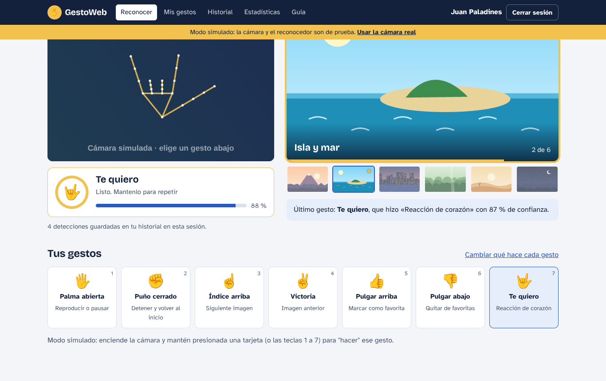

# GestoWeb

Aplicación web que reconoce **7 gestos de la mano** con la cámara del computador y los convierte en acciones dentro de la página (pasar de imagen, pausar, marcar favoritas…). El reconocimiento ocurre en el navegador con **MediaPipe**: la imagen de la cámara nunca sale del computador; al servidor solo viaja qué gesto fue, con qué confianza y a qué hora.

Proyecto de Programación Web — Equipo: Terry, Juan, German y Neils.
Stack: **Angular 20 · Node.js + Express · PostgreSQL 16 · TypeScript**, con **arquitectura hexagonal** y principios **SOLID**.



---

## Puesta en marcha (10 minutos)

### Requisitos
- **Node.js 20 o superior** (`node -v`)
- **PostgreSQL 14 o superior** (instalado, o con Docker: `docker compose up -d`)
- Chrome, Edge o Firefox de escritorio y una cámara web

### 1. Base de datos y backend
```bash
cd backend
npm install
cp .env.example .env          # en Windows: copy .env.example .env
# Abre .env y revisa DATABASE_URL (usuario y contraseña de tu PostgreSQL)
npm run db:crear              # crea la base "gestoweb" con tablas, triggers, vistas y datos
npm run dev                   # API en http://localhost:3000/api
```

### 2. Frontend (en otra terminal)
```bash
cd frontend
npm install
npm run modelo                # descarga el modelo de gestos (≈8 MB) para usarlo sin internet
npm start                     # abre http://localhost:4200
```

### 3. Entrar
- Crea una cuenta en **Crear cuenta**, o usa el administrador de prueba:
  **admin@gestoweb.local** / **Admin123!** (cámbiala antes de publicar).
- Ve a **Reconocer**, pulsa **Encender cámara** y haz un gesto. ☝️ pasa a la siguiente imagen.

> **Sin PostgreSQL:** pon `REPOSITORIOS=memoria` en `backend/.env` y salta `db:crear`. Los datos se pierden al reiniciar.
> **Sin cámara:** abre `http://localhost:4200/?simulado=1`. La cámara y el modelo se reemplazan por adaptadores de prueba y los gestos se "hacen" con botones o con las teclas 1 a 7. Se desactiva con `?simulado=0`.

---

## Comandos

| Dónde | Comando | Qué hace |
|---|---|---|
| backend | `npm run dev` | Servidor con recarga automática |
| backend | `npm run build` y `npm start` | Compila a `dist/` y ejecuta (producción) |
| backend | `npm test` | 51 pruebas: dominio, casos de uso y API (sin base de datos) |
| backend | `npm run test:pg` | 15 pruebas con PostgreSQL: triggers, P-06, P-07 y P-09 |
| backend | `npm run db:crear` | Crea/reinicia la base de datos (**borra los datos**) |
| backend | `npm run db:datos-prueba` | Carga 100 000 detecciones y mide la velocidad (RNF-04) |
| frontend | `npm start` | Angular en http://localhost:4200 (el proxy envía `/api` al backend) |
| frontend | `npm run build` | Compila a `frontend/dist/gestoweb/browser` |
| frontend | `npm test` | 17 pruebas del núcleo del frontend (Karma + Chrome sin ventana) |
| frontend | `npm run modelo` | Descarga el modelo de MediaPipe a `public/assets/modelos/` |
| frontend | `node e2e/recorrido.mjs` | Recorrido completo en modo simulado con capturas (ver instrucciones en el archivo) |

**Un solo servidor para la demo:** compila el frontend (`npm run build`) y en `backend/.env` pon `CARPETA_FRONTEND=../frontend/dist/gestoweb/browser`. Con `npm start` en el backend, todo queda en http://localhost:3000 (la cámara funciona en localhost sin https).

---

## Estructura

```
gestoweb/
├── README.md                  este archivo
├── docker-compose.yml         PostgreSQL con Docker (opcional)
├── docs/                      documentación, capturas, colección de Postman y la SRS
├── base-datos/                01_tablas · 02_funciones_triggers · 03_vistas · 04_datos_iniciales
├── backend/                   API REST con arquitectura hexagonal
│   ├── src/dominio/           entidades y reglas (sin librerías)
│   ├── src/aplicacion/        casos de uso y puertos (contratos)
│   ├── src/infraestructura/   Express, PostgreSQL, memoria, bcrypt, JWT
│   ├── src/main.ts            conecta cada adaptador con su puerto
│   └── pruebas/               Jest
└── frontend/                  Angular
    └── src/app/
        ├── nucleo/            dominio, puertos y servicios (reglas de aceptación, motor)
        ├── adaptadores/       mediapipe · camara · http · simulado
        ├── paginas/           pantallas
        └── compartido/        guards, sesión, avisos, gráficos
```

## Documentación

| Documento | Para quién |
|---|---|
| [Manual de usuario](docs/manual-de-usuario.md) | Cualquier persona que use la aplicación |
| [Guía técnica](docs/guia-tecnica.md) | El equipo: cómo está construido, API, base de datos, configuración, publicación y problemas comunes |
| [Arquitectura hexagonal y SOLID](docs/arquitectura-hexagonal-y-solid.md) | Cómo y por qué se aplicaron, con ejemplos del código |
| [Pruebas](docs/pruebas.md) | Estado de las pruebas P-01 a P-10 y cómo ejecutarlas |
| [Colección de Postman](docs/GestoWeb.postman_collection.json) | Probar la API sin el frontend |
| [SRS](docs/SRS_GestoWeb.pdf) | La especificación original |

## Estado frente a la SRS

- **22/22 requisitos funcionales** implementados (los 9 de prioridad alta, los de media y los de baja).
- **66 pruebas automáticas en el backend y 17 en el frontend**, todas en verde.
- Pruebas de aceptación **P-04, P-05, P-06, P-07 y P-09 aprobadas** (automáticas o en el recorrido de extremo a extremo `frontend/e2e/recorrido.mjs`). P-01, P-02, P-03, P-08 y P-10 necesitan una cámara y personas reales: el procedimiento está en [docs/pruebas.md](docs/pruebas.md).
