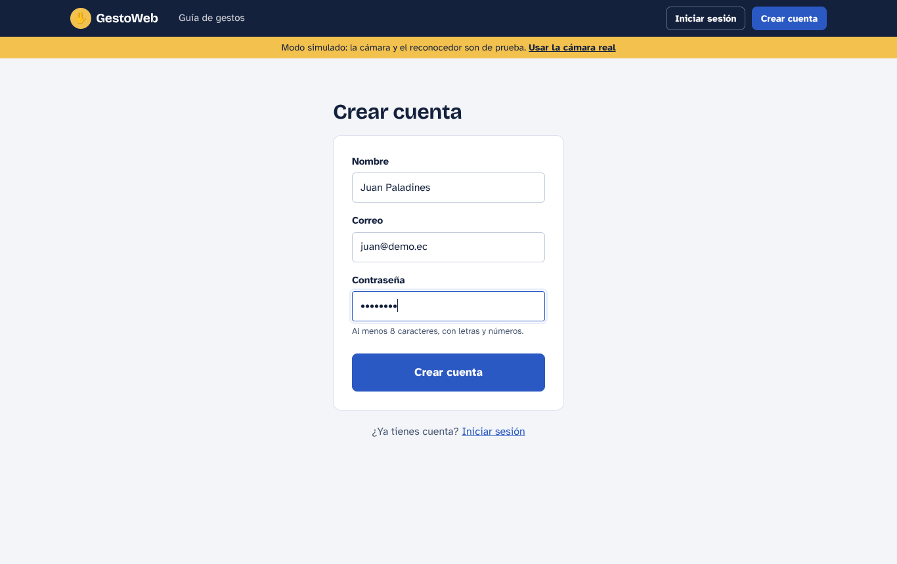
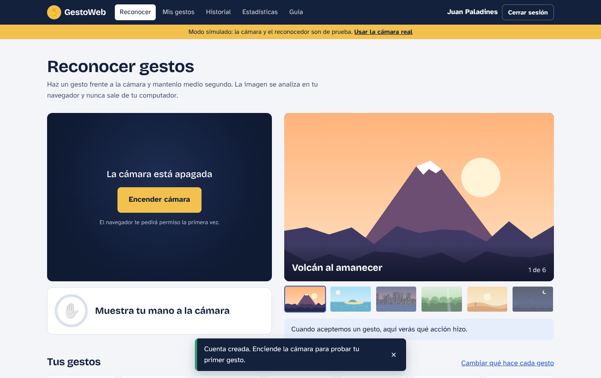
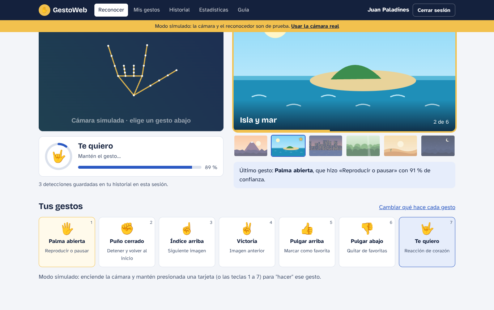
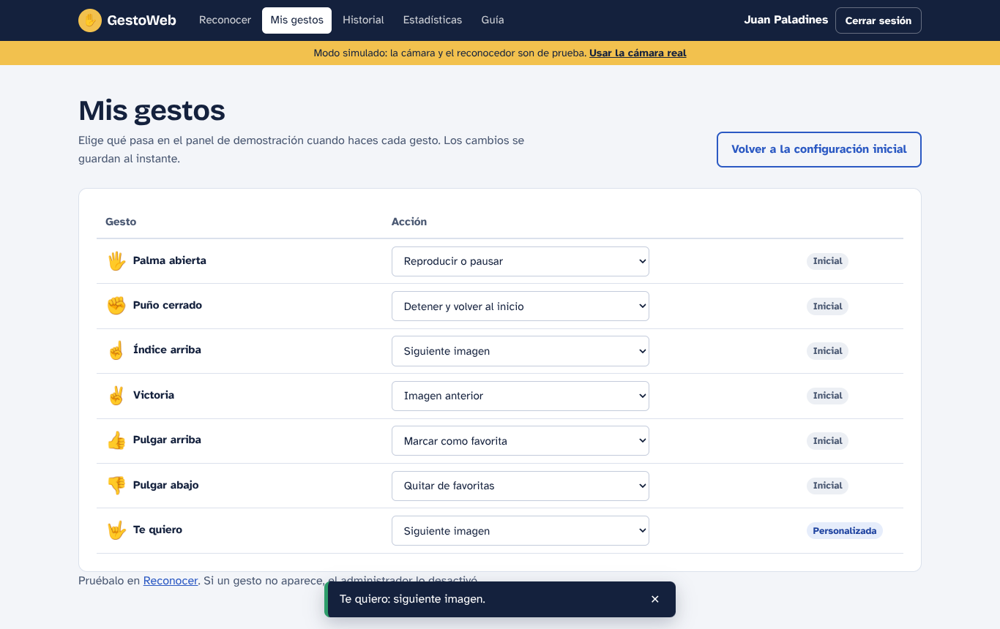
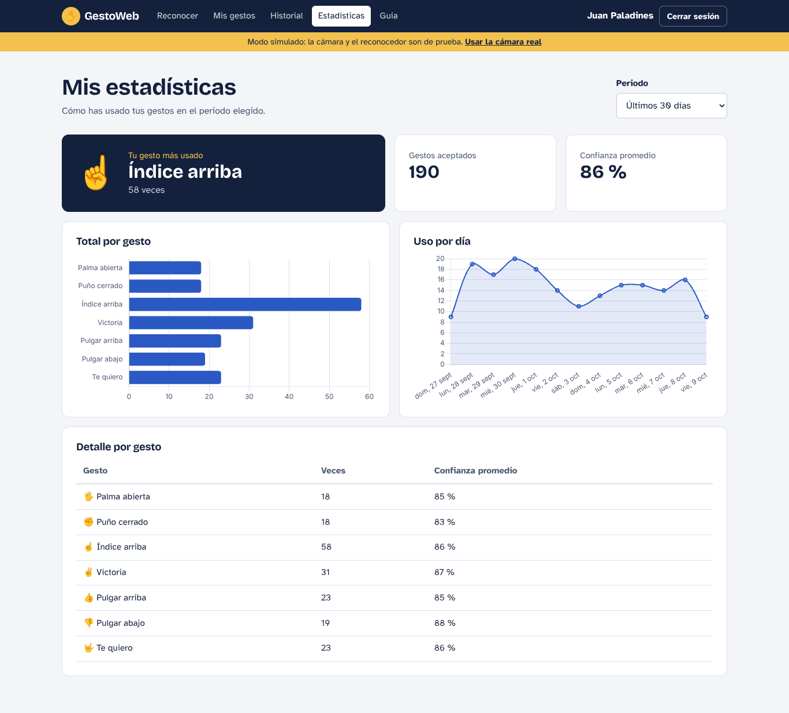
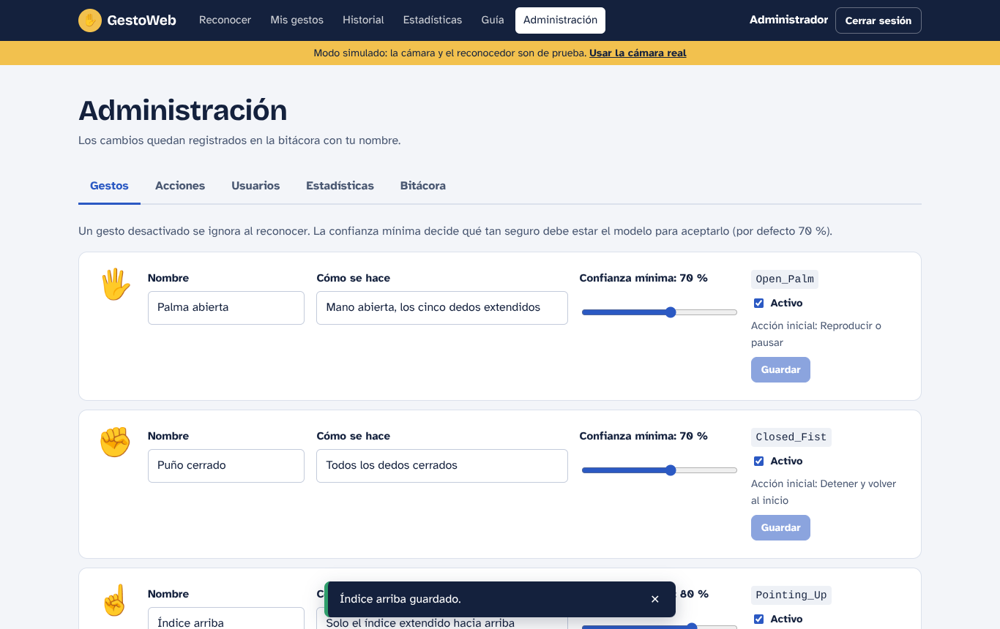
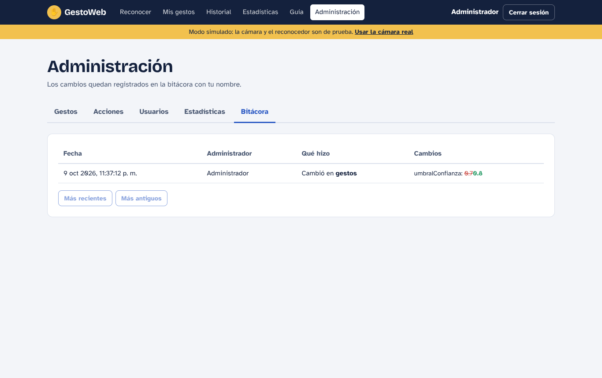

# Manual de usuario de GestoWeb

GestoWeb te deja controlar una página con gestos de tu mano, usando la cámara de tu computador. Este manual explica cómo usarla, paso a paso y sin términos técnicos.

> **Tu privacidad:** la imagen de tu cámara se analiza dentro de tu navegador y **nunca se envía ni se guarda**. Lo único que se guarda es qué gesto hiciste, con qué seguridad y a qué hora.

---

## 1. Lo que necesitas

- Un computador (laptop o de escritorio) o una tableta con **cámara web**.
- **Chrome, Edge o Firefox** actualizados.
- Buena luz de frente. Evita tener una ventana detrás de ti.

## 2. Crear tu cuenta e iniciar sesión

1. Abre GestoWeb y pulsa **Crear cuenta**.
2. Escribe tu nombre, tu correo y una contraseña de **al menos 8 caracteres con letras y números**.
3. Al terminar entras directo a la pantalla **Reconocer**.

La próxima vez usa **Iniciar sesión** con tu correo y contraseña. Tu sesión dura 8 horas; después el sistema te pide entrar de nuevo. Para salir, pulsa **Cerrar sesión** arriba a la derecha.

## 3. Reconocer gestos

1. Pulsa **Encender cámara**. La primera vez el navegador te pregunta si GestoWeb puede usar la cámara: elige **Permitir**.
2. Pon tu mano frente a la cámara, completa y a unos 40–70 cm.
3. Haz un gesto y **mantenlo quieto medio segundo**. El anillo alrededor del ícono se va llenando; cuando se completa, el gesto se acepta.
4. El panel de imágenes de la derecha hace la acción de ese gesto, y abajo aparece qué gesto fue y qué hizo.
5. Si mantienes el gesto, la acción se repite cada segundo (por ejemplo, para avanzar varias imágenes).
6. Cuando termines, pulsa **Apagar cámara**.

**Qué significa cada mensaje bajo la cámara:**

| Mensaje | Qué pasa |
|---|---|
| Muestra tu mano a la cámara | No se ve ninguna mano. |
| Buscando gesto | Se ve tu mano, pero no un gesto conocido o con poca seguridad. |
| *Nombre del gesto* · Mantén el gesto… | Reconoció el gesto; mantenlo hasta que el anillo se llene. |
| Gesto aceptado / Listo. Mantenlo para repetir | Se hizo la acción. |

La barra azul muestra la **confianza**: qué tan seguro está el sistema. Un gesto solo se acepta si la confianza llega al mínimo (normalmente 70 %).

Debajo de la cámara también verás cuántos gestos se guardaron en tu historial. Si se corta la conexión con el servidor, el reconocimiento **sigue funcionando** y los gestos se guardan cuando vuelve la conexión.

## 4. Los 7 gestos

| Gesto | Cómo se hace | Qué hace al inicio |
|---|---|---|
| 🖐️ Palma abierta | Mano abierta, cinco dedos extendidos | Reproducir o pausar el pase automático |
| ✊ Puño cerrado | Todos los dedos cerrados | Detener y volver a la primera imagen |
| ☝️ Índice arriba | Solo el índice hacia arriba | Siguiente imagen |
| ✌️ Victoria | Índice y medio en V | Imagen anterior |
| 👍 Pulgar arriba | Puño con el pulgar hacia arriba | Marcar la imagen como favorita |
| 👎 Pulgar abajo | Puño con el pulgar hacia abajo | Quitar la imagen de favoritas |
| 🤟 Te quiero | Pulgar, índice y meñique extendidos | Mostrar un corazón en pantalla |

En el menú **Guía** tienes cada gesto con consejos para que se reconozca a la primera.

## 5. Cambiar qué hace cada gesto

En **Mis gestos** elige, para cada gesto, la acción que prefieras. Se guarda al instante. Con **Volver a la configuración inicial** todo regresa a la tabla de arriba.

## 6. Historial y estadísticas

- **Historial:** cada gesto aceptado, con fecha, acción, confianza y mano. Puedes filtrar por fechas y por gesto, y **Descargar CSV** para abrirlo en Excel.
- **Estadísticas:** tu gesto más usado, cuántos gestos hiciste, la confianza promedio, un gráfico por gesto y otro por día. Elige el periodo arriba a la derecha.

## 7. Tu perfil

En tu nombre (arriba a la derecha) puedes cambiar cómo te llamas y tu contraseña. Para cambiar la contraseña hay que escribir la actual.

## 8. Si algo no funciona

| Problema | Solución |
|---|---|
| "No diste permiso para usar la cámara" | Haz clic en el ícono de la cámara o del candado en la barra de direcciones, elige **Permitir** y vuelve a encenderla. |
| "La cámara está ocupada" | Cierra Zoom, Meet, Teams u otra app que use la cámara. |
| "No encontramos ninguna cámara" | Conecta una cámara web y vuelve a intentarlo. |
| "La cámara solo funciona en sitios seguros" | Abre la página con **https://** (o en localhost si estás en tu computador). |
| "No se pudo cargar el modelo de gestos" | Revisa tu conexión a internet la primera vez, o pide al equipo que descargue el modelo (`npm run modelo`). |
| El gesto no se acepta | Más luz, mano completa en la imagen, fondo sencillo. Mira la confianza: si está cerca del mínimo, exagera un poco el gesto. |
| Se confunde índice arriba con victoria | Cierra bien los dedos que no usas y separa bien la V. |

---

## Para administradores

Si tu cuenta es de administrador verás el menú **Administración**. Todo cambio queda registrado en la bitácora con tu nombre.

| Pestaña | Qué puedes hacer |
|---|---|
| **Gestos** | Cambiar nombre, descripción y **confianza mínima** de cada gesto, o desactivarlo (se ignora al reconocer). |
| **Acciones** | Crear acciones nuevas, editar su nombre y desactivarlas. Desactivar no borra el historial. Las 8 acciones iniciales son las únicas que el panel sabe ejecutar; una acción nueva queda guardada y muestra un aviso. |
| **Usuarios** | Buscar usuarios, darles o quitarles el rol de administrador y activarlos o desactivarlos. Un usuario inactivo no puede entrar. No puedes quitarte tu propio rol ni desactivarte. |
| **Estadísticas** | Usuarios, sesiones, gestos aceptados, uso de cada gesto y uso por día de todo el sistema. |
| **Bitácora** | Quién cambió qué y cuándo, con el valor anterior y el nuevo. |

